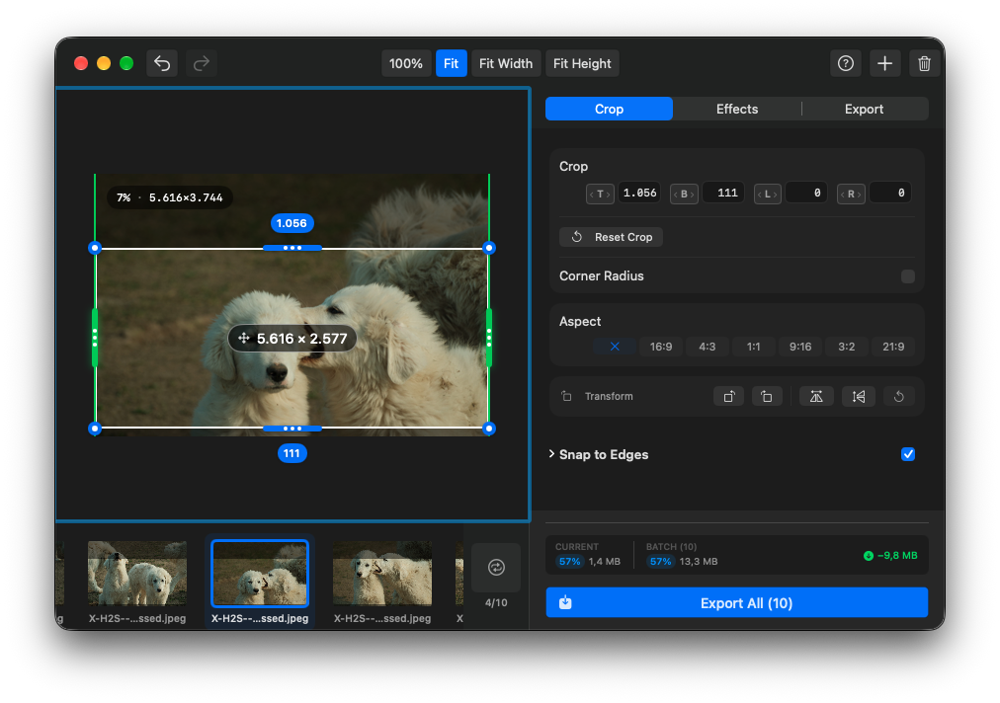
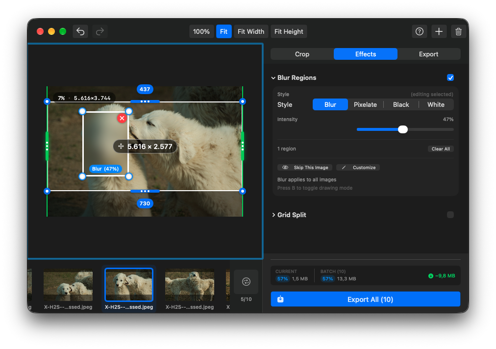
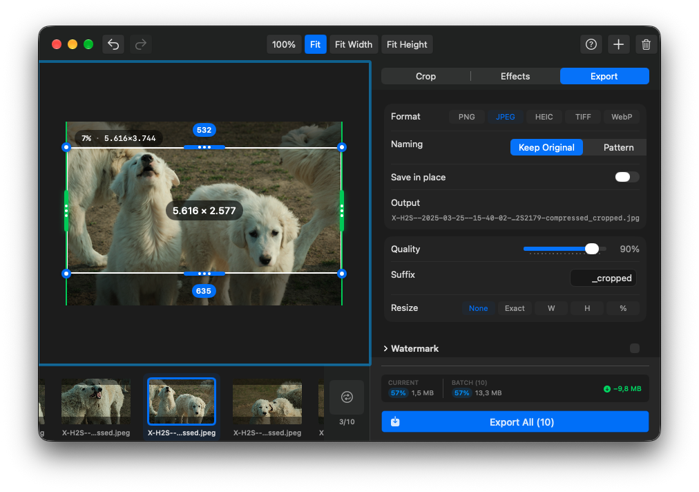
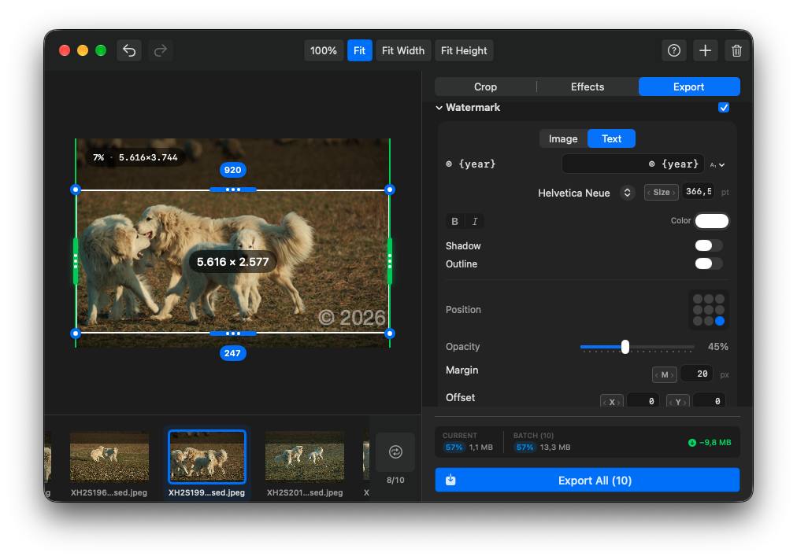

#  CropBatch

Crop, resize, and finish a batch of images in one place. Set the crop once, add blur or a watermark, and export consistent results without repeating the same edits for every file.

A native macOS app for screenshots, photos, and other image batches. Free and open source.


[](https://github.com/Xpycode/CropBatch/releases/latest)


## Screenshots

Preview of the 1.7 interface; the current public download is 1.6.


*Crop — adjust image edges with visual handles and precise crop values across a batch*


*Effects — blur selected regions, customize individual images, or skip an image*


*Export — choose format, quality, naming, and resize options*


*Watermark — add text or image overlays with adjustable position and opacity*

## Features

- **Crop a batch visually** — Drag the crop handles or enter exact edge trims. Scrub the top, bottom, left, and right labels for quick adjustments.
- **Hide sensitive details** — Draw regions over information you want to obscure and adjust the blur intensity.
- **Add watermarks** — Use text or an image, with position and opacity controls. Text supports variables such as the filename and year, plus color, shadow, and outline.
- **Split images into tiles** — Set rows and columns, then export each tile with configurable naming.
- **Round the corners** — Use one radius or set each corner separately; choose PNG or WebP to preserve transparency.
- **Control the output** — Export PNG, JPEG, HEIC, TIFF, or WebP; resize to exact dimensions, limit width or height, or scale by a percentage.
- **Keep batches organized** — Preserve filenames with a suffix or use a naming pattern. Preview estimated file sizes before exporting.
- **Work faster** — Undo and redo edits, use keyboard shortcuts, or watch a folder for incoming images.

## Download

Requires **macOS 15.0 or later**.

1. Download `CropBatch-1.6.dmg` from [GitHub Releases](https://github.com/Xpycode/CropBatch/releases/latest).
2. Open the disk image and drag CropBatch to Applications.
3. Launch CropBatch from Applications.

[App website](https://apps.lucesumbrarum.com/apps/cropbatch.html) · [Report an issue](https://github.com/Xpycode/CropBatch/issues)

**Version 1.7 is in final testing.** The screenshots above show its Crop, Effects, and Export tabs. The public download is still 1.6.

## Usage

1. **Import** your images with drag and drop or Import Images.
2. **Set the crop** using the preview handles or precise edge values.
3. **Finish the batch** with blur regions, corner rounding, grid splitting, or a watermark as needed.
4. **Choose the output** format, dimensions, and filenames, then export to a destination folder.

Save in Place replaces the source files after confirmation and keeps their original formats. Use normal export when you want to keep the originals or convert formats.

### Keyboard Shortcuts

Click the image preview before using its keyboard controls.

| Shortcut | Action |
|----------|--------|
| ← / → | Previous / next image |
| Shift + Arrow | Adjust crop by 1 pixel |
| Shift + Option + Arrow | Expand the crop |
| Add Control to a crop adjustment | Adjust by 10 pixels |
| Cmd + 1 / 2 / 3 / 4 | Actual size / fit / fit width / fit height |
| S | Toggle edge snapping |
| B | Toggle blur drawing mode |
| Cmd + Z / Shift + Cmd + Z | Undo / redo |

## Privacy

Image processing happens locally on your Mac. CropBatch does not upload your images for cropping or export. Update checks contact the update service; in the 1.7 preview, Send Feedback submits the information you choose to provide.

## Building from Source

Requires Xcode 16+ and macOS 15.0+

```bash
git clone https://github.com/Xpycode/CropBatch.git
cd CropBatch/01_Project
xcodebuild -scheme CropBatch -configuration Release
```

## License

MIT
